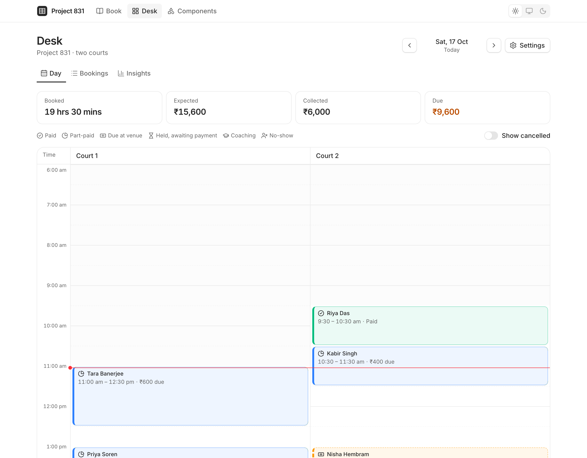
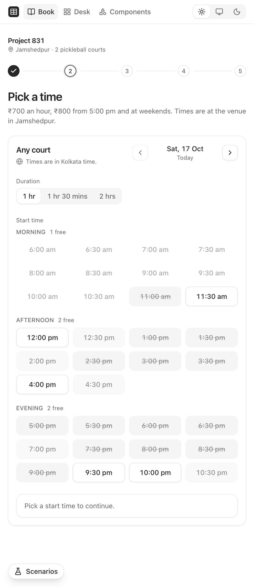
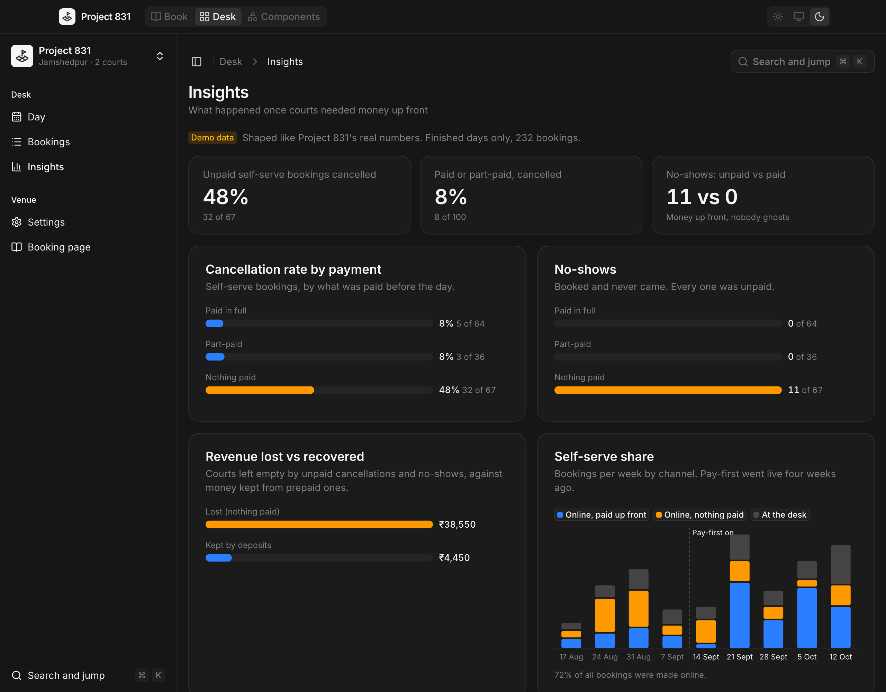

# Court Booking

A court-booking product for a two-court pickleball venue, built end to end with [coss ui](https://coss.com/ui).

**UI primitives are coss ui ([cosscom/ui](https://github.com/cosscom/ui), MIT), installed with the shadcn CLI and unmodified; product components are composed from them.**

**[Live demo →](https://rkj-builds.github.io/slot-picker/)** · the case study it comes from: [Project 831](https://rkj-builds.github.io/project-831-case-study/)

At [Project 831](https://project831.in) in Jamshedpur, self-serve bookings with nothing paid were cancelled 45% of the time, with ten no-shows; bookings paid in full or in part, 7% and none. So the booking engine learned to ask for money before it holds a court: a 50% deposit at weekends, full payment for people who have ghosted before, a 15-minute hold while they pay. This repo rebuilds that product, customer side and venue side, with invented customers and no real money.

<p>
  
</p>

<table>
  <tr>
    <td width="34%"></td>
    <td></td>
  </tr>
</table>

## What's in it

- **Book** (`#/book`, phone first). Five steps with their own URLs: court, time (with a calendar), details (the number confirmed once with a 6-digit code; the demo shows it beside the code boxes, the real 831 sends it on WhatsApp), hold and pay, done. The payment step offers what the policy decides (pay at the venue or now on a weekday; 50% or full at the weekend; full for a pay-first customer), holds the court with a visible countdown, and handles a declined payment, an expired hold and a slot taken mid-payment. Done has the paid and due split, an `.ics`, a WhatsApp share and cancellation with credit or refund. Times show in the venue's zone, and a viewer can add their own (a time-zone combobox).
- **Desk** (`#/desk`, desktop and tablet first; phones get a list). A sidebar for the views and a **⌘K / Ctrl+K palette** (jump to a date, find a customer or booking, new booking). The day as courts by half hours, with a date picker; every booking's ledger in a side sheet (a drawer on a phone) with a WhatsApp message box; right-click a booking for its actions; record cash, mark no-show, cancel, flag pay-first, copy a payment link, each with a toast and an Undo. Plus a bookings table with search suggestions, status and date filters, customer previews on hover and CSV export, and **Insights** charts drawn from the same store.
- **Settings** (`#/desk/settings`). Deposit, prepay days, hold length, pay-first list, hours and prices. Save a 30% deposit and the next customer on `#/book` is asked for 30%.
- **Demo** (top bar, every page). Presets grouped Booking, Payment, Desk and System (weekend, pay-first, trusted regular, code expires, fully booked, closed today, payment fails, slot race, short hold, back-to-back, long names, empty venue, slow network, fail the next load) and **Jump to state**: 74 states, each one click from its screen. Presets are off by default, labelled as a demo, and laid over the data, never saved; `?state=<id>` links to one.
- **Primitives** (`#/primitives`). SlotGrid, Recurrence, TimeZone and DateGrid, each bare, in the booking skin and in the desk skin, with keyboard maps, semantics and motion notes, plus a States index. The demos there also show what Book and the desk do not use yet: a viewer's day shift on the slot grid ("+1 day"), the Repeat editor's clock-change preview, a pinned "Your time zone", and the availability calendar.
- **Components** (`#/components`). All 55 coss ui components, in their states and as the product uses them, light and dark side by side, with the app's own compositions labelled.

## What I obsessed over

- **The policy is one pure function.** `decidePayment(policy, slot, customer)` decides every option a customer sees; the checkout, the desk seed and the tests all call it.
- **Money is integer paise.** Splits put the rounding on one side, so ₹700.01 at 33% still adds back to the paisa; paid and due are derived from the ledger, never stored.
- **A hold is real.** It blocks the slot for everyone, counts down in a meter that announces milestones rather than every second, and releases itself the moment it expires, or when you walk back past "Pay".
- **States are never colour alone.** Every desk block has an icon, a word and a border or texture; every chart has a table for screen readers.
- **One tab stop per grid.** The slot grid and the desk grid both use roving focus; desk cells read "Court 2, 7:00 pm, empty, ₹800 an hour". Their cells are coss Buttons inside a hand-built grid, because coss's Radio Group and Toggle Group have no Page Up/Down between periods, no geometry-aware Up/Down, and skip disabled items that must stay focusable to say why they are taken.
- **Durations are never decimal and times keep their zone.** "1 hour 30 minutes", Asia/Kolkata everywhere, `Intl` only, no date library.
- **Nothing is faked to look finished.** 300–600 ms of latency in the store makes every skeleton real; `?offline=1` shows the error states.

## Primitives

Four headless primitives live in `src/primitives`, shown at `#/primitives`. SlotGrid, Recurrence and TimeZone came out of this product once a second screen needed the same behaviour in a different skin; DateGrid was ported from a companion study (scheduling-primitives) and so far is used on that page only. They follow Base UI's conventions: dot-namespaced parts, a `render` prop on every part, `className` as a string or a function of state, state as `data-*` attributes, controlled or uncontrolled values.

| Primitive | What it owns | API sketch | Used in |
| --- | --- | --- | --- |
| **SlotGrid** | One tab stop, ←→↑↓ / Home / End / Page Up/Down, selection that follows focus, unavailable cells that stay focusable and say why | `<SlotGrid.Root value onValueChange selectionMode="single"\|"none" orientation>` › `.Group` › `.Row` › `.Cell value disabled reason render className={(s) => …}`; `data-selected`, `data-disabled`, `data-highlighted`, `data-unavailable-reason` | Book: start times (a radiogroup). Desk: the day grid (a group of buttons, one column per court) |
| **Recurrence** | Weekly rules (days, interval, hours, until or count, skipped dates) expanded in the venue's zone, DST-correct; one-line summaries from `Intl`; where the clocks change between occurrences, for the venue and for a viewer | `useRecurrence({ value, onValueChange, locale })`, `expandRecurrence(rule, { from, to })`, `summarizeRecurrence(rule, "fr")` → "Chaque samedi et dimanche, 16:00 – 17:00, jusqu’au 30 nov.", `clockChanges(occurrences, zone, viewerZone)` | Desk: Block courts (the Repeat editor); every availability and conflict check, so the Off-Screen Club Juniors weekend hold blocks online booking. The editor's clock-change preview is opt-in (`clockChanges`) and on only at `#/primitives` |
| **TimeZone** | Every IANA zone (`Intl.supportedValuesOf`, with a fallback list) under current names (Katmandu → Kathmandu, Godthab → Nuuk), city and region, the offset at a given instant, search by city, old name, long name, abbreviation (IST, EDT) or offset, an opt-in pinned "Your time zone" | `useTimeZoneCombobox({ value, onValueChange, at, locale, pinned })` → `rootProps` for any Base UI Combobox; `describeZone(id, at)`; `dayShift(instant, venueZone, viewerZone)` → "−1 day", "the day before" (in `src/lib/time-zone.ts`) | Book: "Also show times in", which follows New York across 1 Nov (no pinned group there) |
| **DateGrid** | A WAI-ARIA `role="grid"` month: six fixed rows, the locale's week start (`Intl.Locale` week info), ←→↑↓ / Home / End / Page Up/Down (Shift: a year) that stop at `min` and `max`, one tab stop, a status, label and badge per day in its spoken name, blocked days focusable with `aria-disabled`, an `aria-live` month title | `<DateGrid.Root value onValueChange month min max today getDayInfo>` › `.Title`, `.PreviousMonth`, `.NextMonth`, `.Grid` › `.Head`, `.Body` › `.Cell date` › `.Day`; `data-selected`, `data-disabled`, `data-today`, `data-status`, `data-outside-range` | `#/primitives` only: `AvailabilityCalendar` (prices and fullness) and a compact desk jump-to-date. Book and the desk still use coss's Calendar |

Why primitives: each owns behaviour and semantics, not looks; the booking and desk skins share none of their markup. SlotGrid is a radiogroup rather than an ARIA grid because one value is chosen and a grid would announce row and column numbers that change with the window. Motion is only where it says something (the step change slides the way you moved; the hold countdown gives one beat as it turns amber and red; the availability calendar's month slides 6 px the way you paged), and all of it stops under `prefers-reduced-motion`.

## Components

### coss ui, as installed

`src/components/ui`, `src/hooks` and the coss files in `src/lib` (`segmented-control.ts`, `composer-*.ts`, `utils.ts`) were written by

```sh
npx shadcn@latest add @coss/ui @coss/colors-neutral   # registry: https://coss.com/ui/r/{name}.json (components.json)
```

and are not edited here. To check: reinstall into an empty copy of the project and diff, or `npx shadcn@latest add @coss/ui --diff`. Theme tokens in `src/styles/theme.css` are coss's neutral palette as the CLI wrote them, plus the font contract and base layer from `@coss/style`; the app's own additions there are marked. One of them overrides a coss value without editing it: dark `--muted-foreground` is mixed at 80% instead of coss's 90%, because 90% is about 4.42:1 on a dark card, under WCAG AA for small text; 80% is about 5.3:1. Fonts are Inter and Geist Mono from `@fontsource-variable`, the Vite equivalent of `@coss/fonts`. Dark mode is coss's `.dark` class on `<html>` (set from the OS when the theme is "system").

All 55 coss primitives are installed, and the product uses every one, composed the way coss's docs and particles do (`apps/ui/skills/coss`, `p-*` particles):

| coss component | Where the product uses it |
| --- | --- |
| accordion | Done step: cancellation policy, on the day, why money up front |
| alert | Details step (welcome back, pay first, the demo code), slot taken, declined payment, slot clash in New booking, what happened to the money on Done, empty day hint |
| alert-dialog | Cancel booking (desk and customer), Reset demo data |
| autocomplete | Bookings search with grouped suggestions (customers, phone numbers); the engine under Command |
| avatar | Booking panel and customer preview |
| badge | Booking states, legend, pay-first and credit flags, Verified number, Done status, demo labels, insights legend |
| breadcrumb | Components gallery (the desk has no app header: every page opens with its own title, the sidebar says where you are) |
| button | Every action; links render through it (`render={<Anchor … />}`); slot-grid and desk-grid cells |
| calendar | Date picker in the day stepper (book When step, desk day) and the bookings date range |
| card | Day stats, hero numbers, chart cards, settings sections, summary, home links, booking-summary footer, grid frame |
| checkbox | Opening days, weekend peak, status filter, prepay days |
| checkbox-group | Bookings status filter (in a Popover), Settings prepay days (a form value, per coss) |
| collapsible | Payment history in the booking panel |
| combobox | New booking customer, Settings add pay-first customer, the time-zone picker |
| command | ⌘K / Ctrl+K desk palette |
| composer | "Message on WhatsApp" in the booking panel (demo: toast "Message queued (demo)") |
| context-menu | Right-click (long-press) a booking on the day grid or the phone list |
| dialog | New booking, Record cash, Checkout |
| drawer | Booking panel on phones; order summary on phones (Pay step) |
| empty | Closed day, no results, hold ran out, load errors, empty court list, empty pay-first list, not found |
| field | Every labelled control in Book, Checkout, New booking, Settings, bookings search |
| fieldset | Details step, Settings groups (deposit, prepay days, prices, opening hours), status filter |
| form | Details step, Checkout, New booking, Record cash, Settings |
| frame | Bookings table and pagination, checkout amount |
| group | Day stepper: previous / Today / date / next |
| input | Names, UPI ID |
| input-group | Mobile number with its +91 addon |
| kbd | ⌘K hints, palette footer |
| label | Number fields, switches in the Demo control, radio cards |
| menu | Bookings row actions, sidebar venue switcher, the top bar's More menu on narrow screens |
| meter | Hold countdown |
| number-field | Players, deposit, prices, cash received |
| otp-field | 6-digit WhatsApp code on the details step |
| pagination | Bookings table |
| popover | Date pickers, status filter, the Demo control |
| preview-card | Hover a customer's name in Bookings: bookings, paid ahead, unpaid, no-shows, cancelled, pay-first, last and next visit |
| progress | Checkout "Waiting for the bank…" |
| radio-group | Court, pay mode, credit or refund, segmented controls |
| scroll-area | Day grid's sideways scroll; inside Sidebar, Select, Command |
| select | Court, start, duration, hold length, opening times |
| separator | Panel and summary dividers, desk header |
| sheet | Booking panel on a laptop |
| sidebar | Desk navigation: views, venue switcher, ⌘K entry; icons when collapsed (⌘B), a sheet on phones |
| skeleton | Store loading for Book and Desk, slot grid loading |
| slider | Deposit percent |
| spinner | Lazy-loaded desk and gallery; inside loading Buttons |
| switch | Pay first, new-customer deposit, scenarios |
| table | Bookings, opening hours, pay-first list, payment history, insights tables for screen readers |
| tabs | Checkout: UPI or card |
| textarea | Booking notes |
| toast | Every desk action with Undo, payments, messages; four seconds, and on a phone the page makes room above the action bar |
| toggle | "Show cancelled" in the Day page header |
| toggle-group | Bookings quick dates (Last 7 days / Today / Next 7 days), clearable; the Repeat editor's days |
| toolbar | Bookings filters and export, the search framed to the same height; the gallery's day actions |
| tooltip | Empty grid cells, day-stepper buttons, time-zone hint, collapsed sidebar |

Only two project settings bend around the vendored code, and neither touches a coss file: ESLint skips the coss files (they are linted upstream under different rules), and `tsconfig.json` sets `noUnusedLocals: false` because `src/lib/composer-editor.ts` has one unused type import upstream. typescript-eslint's `no-unused-vars` still checks all app code.

### The app's compositions

What coss does not ship is built from coss parts, outside `src/components/ui`:

- `src/components/compositions/segmented-control.tsx`: coss Radio Group primitives with coss's `@coss/segmented-control` recipe, the way coss's segmented-control guide says to build a one-of-many choice.
- `src/components/compositions/radio-card.tsx`: coss's card-radio pattern, a `Label` wrapping a `Radio`.
- `src/components/compositions/stepper.tsx`: the booking flow's numbered steps.
- `src/components/booking/`: `BookingSlotPicker`, `SlotGrid`, `DayStepper`, `DurationPicker`, `TimeZoneHint`, still exported from `src/index.ts`. `DayStepper` is a coss Group around coss's date-picker particle (Popover + Calendar).
- `src/components/compositions/repeat-editor.tsx` and `time-zone-combobox.tsx`: the Recurrence and TimeZone primitives in coss parts.
- `src/components/compositions/availability-calendar.tsx`: the DateGrid primitive with coss Buttons to page; the price under each day sits outside the day's button, so the button's visible text matches its name (WCAG 2.5.3).
- The slot grid and the desk grid both run on the SlotGrid primitive, because coss's Radio Group and Toggle Group have no Page Up/Down between periods, no geometry-aware Up/Down and skip disabled items that must stay focusable; every cell inside is a coss Button.
- `src/app/anchor.tsx`: the one plain `<a>`, for coss parts that render as links (`render={<Anchor href="…" />}`) and coss's segmented navigation links.
- The charts in `src/app/desk/insights-view.tsx` are inline SVG inside coss Cards (coss has no chart), each with a coss Table for screen readers.

## Run it

```sh
npm install
npm run dev          # http://localhost:5173 — then #/book, #/desk, #/primitives, #/components
npm test             # Vitest + Testing Library + axe (flows, policy, holds, reducer)
npm run typecheck    # tsc, strict
npm run lint         # ESLint with jsx-a11y and react-hooks
npm run build        # tsc + vite build, served from /slot-picker/
npm run screenshots  # headless Chrome → docs/{book,desk,insights}-{light,dark}.png
```

URL switches: `?theme=light|dark`, `?now=2026-10-17T05:30:00Z` to pin the clock, `?offline=1` for the error states, `?state=<id>` for any demo state (ids in `src/app/demo-states.ts`). **Reset demo data** lives in the Demo control and in Settings.

## Stack

React 19, TypeScript, Vite, Tailwind v4, coss ui on `@base-ui/react`, Vitest. No router, state, chart or date library: a hash router, a reducer in context, inline SVG and `Intl`.

MIT © Rahul Jha. coss ui is MIT © coss.com; see [THIRD_PARTY_NOTICES.md](THIRD_PARTY_NOTICES.md).
