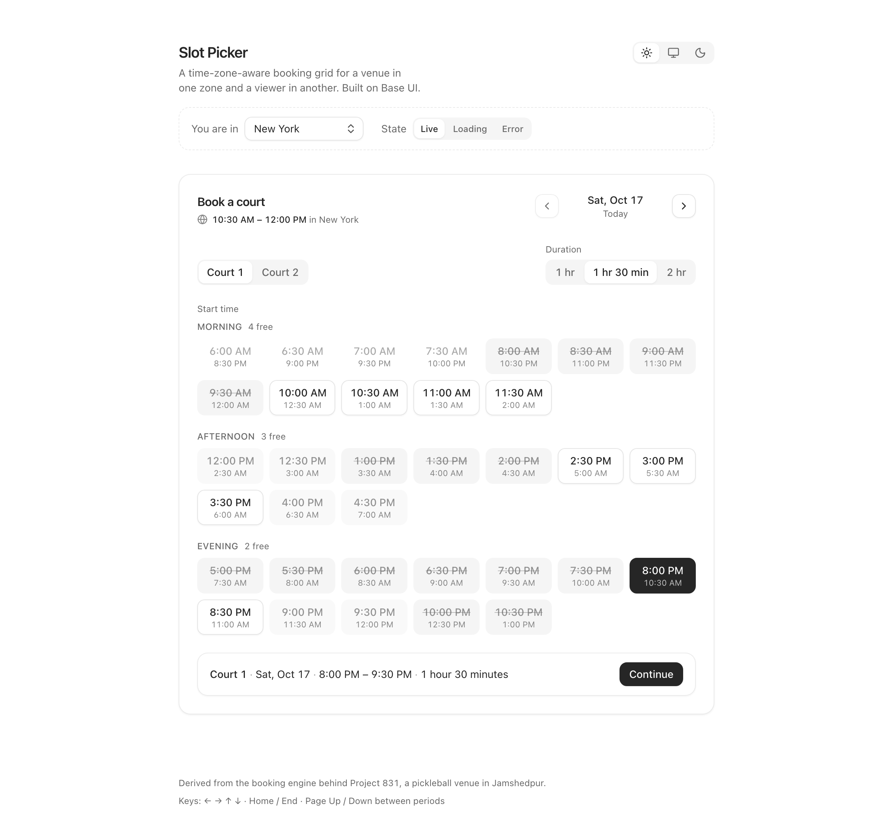
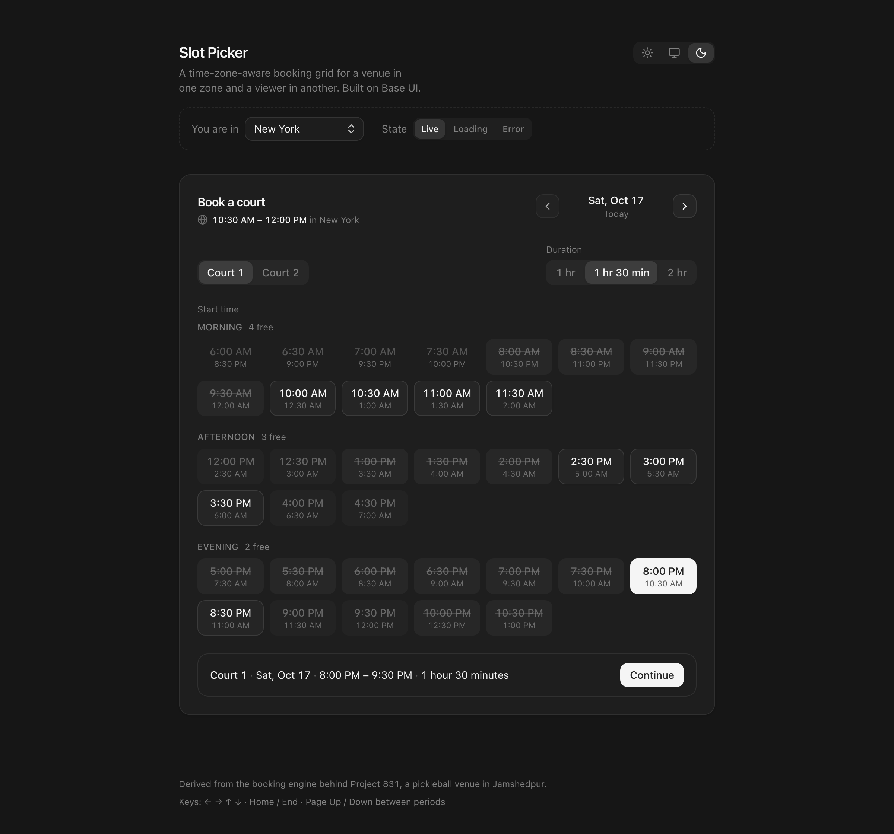

# Slot Picker

A time-zone-aware booking slot picker for React, built on [Base UI](https://base-ui.com) in the [coss ui](https://coss.com/ui) style.

**[Live demo →](https://rkj-builds.github.io/slot-picker/)** · try `?tz=America/New_York` · the case study it comes from: [Project 831](https://rkj-builds.github.io/project-831-case-study/)

<p>
  
</p>

<details>
  <summary>Dark mode</summary>
  
</details>

The venue lives in one zone (Asia/Kolkata). The viewer may be anywhere. Every time is printed on the venue's clock, with the viewer's equivalent one line below. It is lifted from the booking engine behind [Project 831](https://project831.in), a pickleball venue in Jamshedpur, with the business data left behind.

## What I obsessed over

- **The keyboard model.** One tab stop. Arrows move, Home/End jump, Page Up/Down hop between morning, afternoon and evening. Unavailable slots stay reachable and say why: "7:30 PM, booked".
- **Time zones with no library.** `Intl` and `Date` math only. The spring-forward gap moves forward, the fall-back overlap takes the earlier instant, and a test pins a Kolkata evening as seen from New York across 1 Nov 2026.
- **Durations are never decimal.** "1 hour 30 minutes", never "1.5 hours", in every locale, built from `Intl.NumberFormat` and `Intl.ListFormat`.
- **Real states.** Loading skeleton, "No slots left today" with a jump to the next free day, an error with retry, and six slot statuses that each explain themselves.
- **Base UI underneath, by hand where it matters.** Radio Group, Select and Tooltip are composed from Base UI. The grid is hand-built because no primitive knows what a period is.
- **Motion with restraint.** One easing, 150 ms, and nothing moves under `prefers-reduced-motion`.

## Usage

```tsx
import { BookingSlotPicker } from "./src";

<BookingSlotPicker
  schedule={{
    timeZone: "Asia/Kolkata",
    slotStepMinutes: 30,
    durationsMinutes: [60, 90, 120],
    weeklyHours: { sat: [[6 * 60, 23 * 60]], /* ... */ },
  }}
  spaces={[{ id: "court-1", name: "Court 1" }, { id: "court-2", name: "Court 2" }]}
  reservations={[{ spaceId: "court-1", start, end, status: "booked" }]}
  viewerTimeZone={localTimeZone()}
  onConfirm={(selection) => console.log(selection)}
/>
```

Each part is usable on its own: `DurationPicker`, `SlotGrid`, `DayStepper`, `TimeZoneHint`, and the pure helpers in `src/lib` (`computeDaySlots`, `instantFromWallClock`, `formatDuration`).

The demo takes `?theme=light|dark`, `?locale=en-US`, `?tz=America/New_York` for the viewer, `?slot=2026-10-17T19:00&duration=90` to seed a selection, and `?now=2026-10-17T03:30:00Z` to pin the clock.

## Scripts

```sh
npm run dev          # the demo page
npm test             # Vitest + Testing Library + axe
npm run typecheck    # tsc, strict
npm run lint         # ESLint with jsx-a11y and react-hooks
npm run build        # tsc + vite build
npm run screenshots  # headless Chrome → docs/screenshot-{light,dark}.png
```

## Stack

React 19, TypeScript, Vite, Tailwind v4, `@base-ui/react`, Vitest. No date library.

MIT © Rahul Jha
